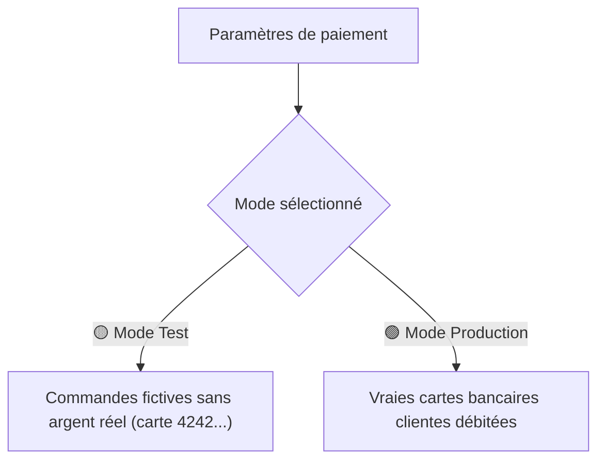

# 📖 Guide d'Utilisation — Administration Precept France
*Guide pratique et simple pour l'équipe non-technique*

Bienvenue dans l'espace d'administration de **Precept France** ! Ce guide a été conçu pour vous accompagner pas-à-pas dans la gestion quotidienne de votre boutique, de vos commandes et de vos contenus, sans aucun jargon technique.

---

## 📑 Sommaire
1. [Comment se connecter](#1-comment-se-connecter)
2. [Découvrir le menu d'administration](#2-découvrir-le-menu-dadministration)
3. [Gérer les commandes de livres](#3-gérer-les-commandes-de-livres)
4. [Gérer le catalogue des livres & les prix](#4-gérer-le-catalogue-des-livres--les-prix)
5. [Gérer les Ateliers hebdomadaires sur Zoom](#5-gérer-les-ateliers-hebdomadaires-sur-zoom)
6. [Consulter les messages de contact](#6-consulter-les-messages-de-contact)
7. [Gérer les paiements Stripe (Mode Test vs Mode Réel)](#7-gérer-les-paiements-stripe)
8. [Les ressources gratuites & outils](#8-les-ressources-gratuites--outils)
9. [Foire aux Questions & Dépannage rapide](#9-foire-aux-questions--dépannage-rapide)

---

## 1. Comment se connecter

1. Ouvrez votre navigateur internet (Chrome, Safari, Firefox, Edge).
2. Rendez-vous à l'adresse suivante :  
   👉 **[https://www.preceptfrance.fr/admin](https://www.preceptfrance.fr/admin)**
3. Saisissez votre **mot de passe administrateur**.
4. Cliquez sur **Se connecter**.

> [!TIP]
> **Astuce :** Vous pouvez enregistrer cette page dans les favoris de votre navigateur (icône d'étoile ⭐) pour y accéder en un clic lors de vos prochaines visites.

---

## 2. Découvrir le menu d'administration

Une fois connecté, vous disposez d'un **menu latéral à gauche** avec 6 sections principales :

| Section | Rôle |
| :--- | :--- |
| 📊 **Tableau de bord** | Vue générale : total des ventes, ateliers actifs, commandes en attente, messages reçus. |
| 📚 **Livres** | Vos 42 livres : modifier les prix, marquer un livre comme épuisé, associer un extrait PDF. |
| 🎥 **Ateliers** | Vos rencontres hebdomadaires sur Zoom : horaires, lien Zoom, livre lié (facultatif) et extrait PDF. |
| 📦 **Commandes** | Liste de toutes les commandes passées par les clients (adresses de livraison, articles commandés). |
| 💬 **Messages** | Messages envoyés par les visiteurs via le formulaire de contact, demandes de groupe et ateliers. |
| ⚙️ **Paramètres** | Configuration des paiements Stripe (basculer entre le mode Test et le mode Réel). |

---

## 3. Gérer les commandes de livres

Dès qu'un client effectue un achat sur le site, sa commande apparaît instantanément dans l'onglet **Commandes** (`/admin/commandes`).

### Que se passe-t-il automatiquement ?
- Le client règle par carte bancaire de façon 100 % sécurisée via Stripe.
- Le client reçoit automatiquement un **e-mail de confirmation** avec le récapitulatif de ses achats.
- L'équipe Precept France reçoit également une **notification par e-mail** à l'adresse `contact@preceptfrance.fr`.

### Comment traiter une commande à expédier ?
1. Cliquez sur **Commandes** dans le menu de gauche.
2. Cliquez sur la commande concernée pour ouvrir sa fiche détaillée :
   - Vous y trouvez le **nom complet** et l'**adresse e-mail** du client.
   - L'**adresse postale complète de livraison** indiquée par le client.
   - La **liste des livres** commandés avec les quantités.
3. Préparez le colis depuis votre lieu de stockage (ex. *13 Rue Adèle, 92220 Bagneux*).
4. Expédiez le colis via votre transporteur habituel (La Poste Colissimo, Mondial Relay, etc.).

---

## 4. Gérer le catalogue des livres & les prix

Rendez-vous dans la rubrique **Livres** (`/admin/livres`) pour voir l'ensemble des 42 livres répartis par collection :
- **Série 40 Minutes** : Études thématiques courtes (11,99 €)
- **Série Seigneur** : Études sur la prière et la relation avec Dieu (16,99 € à 19,99 €)
- **Découvre et Déterre (D&D)** : Études adaptées aux enfants et ados (14,99 € et 15,99 €)
- **Études inductives** : Josué, Galates, Hébreux, Pentateuque (11,99 € à 13,99 €)
- **Saisir et Agir** : Philippiens (22,99 €)
- **Précepte sur Précepte (PUP)** : Études approfondies verset par verset (11,99 € à 32,99 €)

### Actions fréquentes :

#### A. Modifier le prix ou le texte d'un livre
1. Cliquez sur le livre à modifier.
2. Changez le montant dans la case **Prix (€)** (par exemple : remplacer `11.99` par `12.50`).
3. Vous pouvez également ajuster le titre ou la description si besoin.
4. Cliquez sur **Enregistrer les modifications**. Le nouveau prix apparaît immédiatement sur le site.

#### B. Marquer un livre comme "Épuisé" (Rupture temporaire de stock)
Si vous n'avez plus d'exemplaires physiques d'un livre :
1. Ouvrez la fiche du livre.
2. Cochez l'option **Épuisé (Sold out)**.
3. Enregistrez.
> **Résultat sur le site :** Les visiteurs verront toujours la couverture et la description du livre, mais le bouton "Ajouter au panier" sera remplacé par la mention grisée **« Épuisé »**, empêchant toute commande impossible à honorer. Dès réception de nouveaux exemplaires, décochez simplement la case !

#### C. Gérer les extraits PDF et documents d’accompagnement
Chaque livre peut avoir un extrait PDF gratuit (Semaine 1, leçon d'exemple, guide) associé :
- **Sur le site public :** Les visiteurs voient un bouton **« Feuilleter l’extrait gratuit (PDF) »** et un badge discret sur la couverture.
- **Dans l'administration (`/admin/livres/[id]`) :** Une section dédiée **« Extrait PDF / Document d’accompagnement »** vous permet de tout gérer simplement :
  1. **Lier un PDF existant :** Choisissez parmi les **45 PDF déjà intégrés** au site via le menu déroulant (classés par série : 40 Minutes, Seigneur, Enfants D&D, PUP, Études Éclair, Outils).
  2. **Téléverser un nouveau PDF :** Cliquez sur *« Choisir un fichier »* pour envoyer un PDF depuis votre ordinateur (jusqu'à 8 Mo). Il remplacera automatiquement l'extrait actuel.
  3. **Visualiser le PDF actuel :** Cliquez sur le bouton bleu *« Voir le PDF »* pour l'ouvrir dans un nouvel onglet et vérifier son contenu.
  4. **Supprimer / Dissocier le PDF :** Cochez la case rouge *« Supprimer / Retirer ce document PDF de ce livre »* et enregistrez. Le bouton d'extrait disparaîtra immédiatement de la fiche du livre.
  5. **Lien direct / externe (facultatif) :** Si un document est hébergé sur un serveur externe ou un drive partagé, vous pouvez coller son adresse web directe.

---

## 5. Gérer les Ateliers hebdomadaires sur Zoom

Rendez-vous dans la rubrique **Ateliers** (`/admin/ateliers`) pour gérer la page publique **[https://www.preceptfrance.fr/ateliers](https://www.preceptfrance.fr/ateliers)**.

### Comment ajouter ou modifier un atelier ?
1. Cliquez sur **Ajouter un atelier** (ou sur **Modifier** face à un atelier existant).
2. Renseignez :
   - **Titre / Thème de l’atelier** (ex. *Seigneur, enseigne-moi à prier — Étude hebdomadaire*).
   - **Rythme & Horaire affiché** (ex. *Tous les mardis de 20h00 à 21h30*).
   - **Date et heure de la prochaine séance (facultatif)** : active les boutons **« Ajouter à Google Agenda / Apple / Outlook (.ics) »** sur la carte de l'atelier.
   - **Lien de la réunion Zoom** (`https://...`) et éventuellement l'**ID de réunion / Code secret**.
   - **Livre d’étude associé (facultatif)** : choisissez un livre de la boutique dans la liste déroulante.
     - L'atelier récupère **automatiquement** la couverture du livre, le bouton **« Acheter le livre (facultatif) »** ainsi que son **extrait PDF gratuit** (Semaine 1) pour que même les participants qui ne peuvent pas acheter le livre puissent suivre la rencontre !
   - **Mettre à la une** : cochez cette case pour afficher l'atelier en grand tout en haut de la page `/ateliers`.
3. **Partage sur WhatsApp & Réseaux sociaux :**
   - Sur la page publique `/ateliers`, chaque atelier possède un bouton vert **« Partager sur WhatsApp »** ainsi qu'un bouton **« Partager »** (Facebook, Instagram, Email, Inviter mon groupe) qui prépare automatiquement un message complet avec le titre, l'horaire, le lien Zoom et le lien vers l'extrait PDF gratuit.

---

## 6. Consulter les messages de contact

Rendez-vous dans **Messages** (`/admin/messages`).

- Cette page regroupe toutes les demandes formulées depuis le site :
  - Questions sur une commande
  - Demandes de chrétiens ou responsables souhaitant **démarrer ou rejoindre un groupe d'étude**
  - Questions sur les **Ateliers Zoom**
  - Messages généraux
- Chaque ligne affiche le nom, l'email, la date et le message.
- Vous pouvez cliquer sur l'adresse email pour répondre directement depuis votre boîte de messagerie (`contact@preceptfrance.fr`).

---

## 7. Gérer les paiements Stripe

Rendez-vous dans **Paramètres** (`/admin/parametres`).

La boutique Precept France utilise **Stripe**, le système de paiement sécurisé de référence. Vous pouvez basculer la boutique entre deux modes d'un simple clic :

### 🟡 Le Mode Test (Pour s'entraîner ou vérifier)
- Permet de faire des commandes d'essai avec la carte test `4242 4242 4242 4242` (n'importe quelle date future, code 123).
- **Aucun argent réel n'est prélevé.**
- Idéal pour vérifier qu'une commande fonctionne bien.

### 🟢 Le Mode Production (Pour les vraies ventes)
- Dès que vous êtes prêt à recevoir les paiements de vrais clients, activez le bouton **Mode Production**.
- Les clés sont déjà renseignées et sécurisées.
- Les fonds payés par les acheteurs arrivent directement sur le compte bancaire de l'association Precept France.

---

## 8. Les ressources gratuites & outils

Votre site propose désormais un espace dédié aux ressources gratuites accessible via l'onglet **Ressources** :  
👉 **[https://www.preceptfrance.fr/ressources](https://www.preceptfrance.fr/ressources)**

### Ce qui est offert aux internautes :
1. **7 études bibliques complètes** :
   - *Un meilleur sacrifice* (Hébreux 10)
   - *Crier à Dieu dans la détresse* (Psaume 102)
   - *Comment savoir la vérité sur Dieu ?* (Jean 1)
   - *Dieu parle !* (Psaume 19)
   - *Enflammez votre foi* (Psaume 23)
   - *La paix de Dieu* (Philippiens 4)
   - *Courir pour remporter le prix*
2. **Des outils méthodologiques téléchargeables en 1 clic** :
   - La brochure officielle de la méthode inductive (230 Ko)
   - Le signet des symboles et mots-clés (pour surligner sa Bible)
   - Le signet mémo O-I-A (*Observer, Interpréter, Appliquer*)
   - Le guide pour choisir l'étude idéale

> [!TIP]
> **Comment utiliser ces ressources pour votre ministère ?**  
> Vous pouvez imprimer ces fiches ou envoyer le lien `https://www.preceptfrance.fr/ressources` à des pasteurs, des responsables de jeunesse ou lors de vos ateliers pour faire découvrir la méthode gratuitement.

---

## 9. Foire aux Questions & Dépannage rapide

### ❓ Un client dit qu'il n'a pas reçu son email de confirmation de commande ?
1. Vérifiez d'abord dans `/admin/commandes` que sa commande apparaît bien comme **Payée**.
2. Demandez au client de vérifier son dossier **Courriers indésirables / Spams**.
3. Vous pouvez lui renvoyer un email manuel récapitulatif depuis `contact@preceptfrance.fr` avec les détails de sa commande affichés dans l'admin.

### ❓ Comment modifier les informations légales (téléphone, président, adresse) ?
Les mentions légales et conditions de vente sont rédigées conformément à la loi française avec :
- Numéro RNA : **RNA W943 008 438**
- Numéro SIRET : **89759499000011**
- Adresse : **13 Rue Adèle, 92220 Bagneux**
- Représentant légal : **Ammiel KOUADIO**
- Téléphone : **+33 7 64 62 71 13**  
Si ces informations changent dans le futur, il suffit de demander la mise à jour dans le fichier de configuration légale.

### ❓ Est-ce que les modifications de prix ou d'ateliers prennent du temps à s'afficher ?
Non ! Toute modification enregistrée dans l'administration (prix, stock, description, ateliers Zoom) est immédiate. Si vous ne voyez pas le changement sur votre écran, rechargez simplement la page de votre navigateur (raccourci `Ctrl + F5` sur Windows ou `Cmd + Shift + R` sur Mac).

---

*Guide rédigé pour l'équipe de l'association Precept France.*
